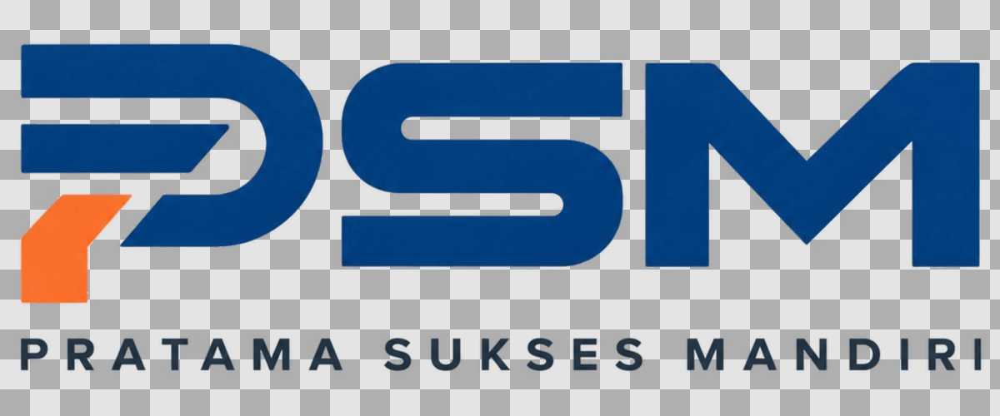
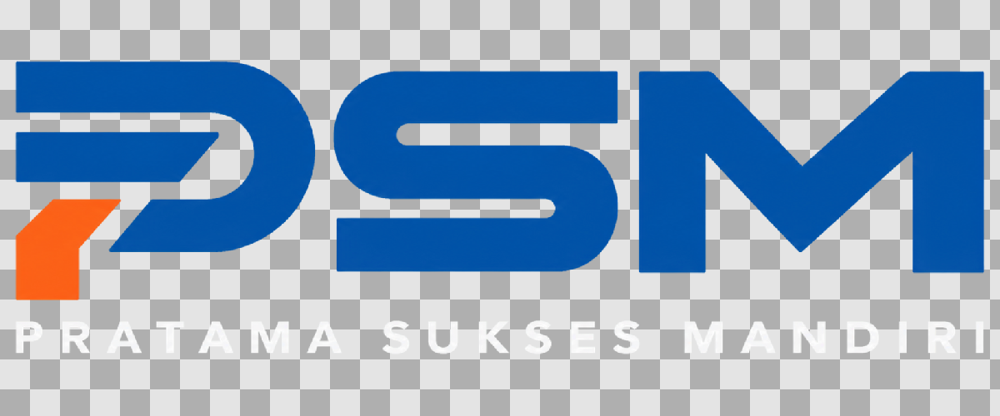

# Transparent PSM logo preview sheet

These previews are composites of the final RGBA asset candidates—not colored background rectangles. The asset artwork itself is identical in every panel.

- Header output: [`source/assets/psm-header-transparent.png`](../../../source/assets/psm-header-transparent.png), 3538×1297.
- Footer output: [`source/assets/psm-footer-transparent.png`](../../../source/assets/psm-footer-transparent.png), 1656×537 RGBA, derived from the corrected owner source `Logo/PSM Footer Corrected.png` (2000×2000 RGB, no source alpha, uniform near-black `#000001`).
- Preview panels are 1200×500. Site background colors were read in Chrome: header `rgba(255, 255, 255, 0.98)` (previewed over effective near-white `#FEFEFE`), footer `#151719`.

## Header — from `PSM White Background.png`

**White**

**Black**

**Website header background**

**Website footer background**

**Checkerboard transparency**

## Footer — from `PSM Footer Corrected.png`

The corrected source preserves the blue PSM mark (`#0052A7` median), orange detail (`#FB6117` median), and near-white tagline (`#F6F6F7` median). The exact near-black matte (`#000001`) was verified along all four image edges. Matte removal estimates coverage against the measured source colors and unblends antialiased edges; the visible artwork was not redrawn, reconstructed, recolored, or resized. The crop retains 24 source pixels of transparent padding around the complete artwork.

**White**

**Black**

**Website header background**

**Website footer background**

**Checkerboard transparency**

